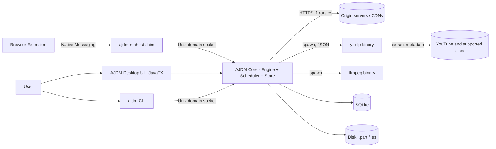
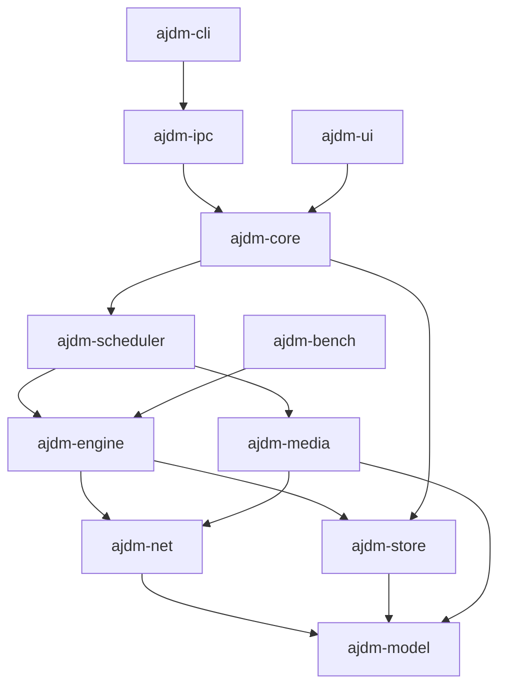
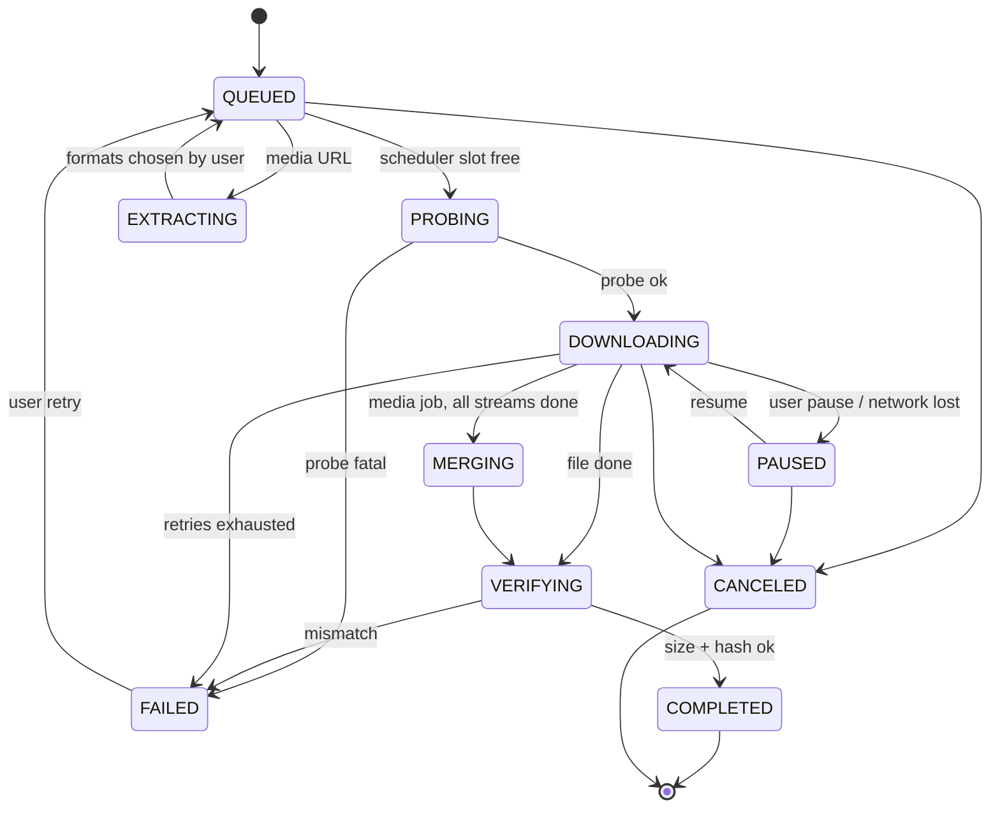

<p align="center">
  
</p>

# AJDM — Architecture Specification

**Ariga Justine Download Manager** · *My brother. My legacy.*

| | |
|---|---|
| Document | `architecture.md` |
| Version | 1.0 (design baseline) |
| Date | 2026-10-01 |
| Author | Ethan |
| Companion | `AJDM_PRD.pdf` (requirement IDs such as `ENG-03` refer to the PRD) |
| Status | Approved for implementation; open items in section 23 |

---

## 0. How to read this document

- Sections 1–5 explain **what is being built and why these choices**.
- Sections 6–12 are the **normative design** of the transfer engine, media pipeline, storage and IPC. Where a value is written `like_this`, it is a named setting with the default given in section 14.
- Sections 13–22 cover UI, security, packaging, testing and failure handling.
- "MUST / SHOULD / MAY" follow RFC 2119.

---

## 1. Purpose and scope

AJDM is a **cross-platform desktop download manager** (Windows, macOS, Linux) with two headline capabilities:

1. **Fast segmented downloading** of any HTTP(S) file, engineered to match or beat Internet Download Manager (IDM) on 4G/5G and broadband links.
2. **Media extraction**: given a video or playlist URL (YouTube and every site supported by `yt-dlp`), list every available format/quality (audio, video, up to 2160p by default), let the user pick, then download with the AJDM engine, not with `yt-dlp`'s own downloader.

### In scope (v1.0)
HTTP/HTTPS (HTTP/1.1 default, HTTP/2 optional), resume, queue/scheduler, media extraction, ffmpeg muxing, JavaFX UI, CLI, browser extension, installers.

### Out of scope (v1.0)
FTP/SFTP, BitTorrent, DRM-protected streams, site-specific accounts beyond cookies/Basic auth, mobile apps, cloud sync.

---

## 2. Architectural drivers

Ranked. When two conflict, the higher one wins.

| # | Driver | Concrete target |
|---|---|---|
| 1 | **Data correctness** | Output is bit-identical to the source. 0 corrupted files across the chaos suite (section 19). |
| 2 | **Throughput** | Reach >= 95% of `min(link capacity, servable capacity)`; beat IDM median time in the benchmark matrix (PRD section 12). |
| 3 | **Resilience** | Survive disconnects, IP changes, expired URLs, app crashes, power loss; lose at most `checkpointInterval` of progress. |
| 4 | **Portability** | One codebase, three OSes, no OS-specific engine code. OS integration only at the edges. |
| 5 | **Maintainability** | A solo developer can own it: few moving parts, strict module boundaries, boring technology. |
| 6 | **Footprint** | Idle RSS <= 200 MB, cold start <= 2 s (with AppCDS). |

---

## 3. Technology decisions (ADR summary)

| ID | Decision | Rationale | Alternatives rejected |
|---|---|---|---|
| ADR-01 | **Java 25 (LTS)** for everything except bundled tools | Virtual threads (stable), JEP 491 removed `synchronized` pinning in 24, Scoped Values final in 25, mature NIO. Author already productive in Java. | C++ core + JNI: the workload is network-bound, JNI adds build and crash complexity for no measurable gain. Rust/Go: not chosen, author decision. |
| ADR-02 | **Virtual threads** for network workers, **platform threads** for disk and JNI | Sockets park virtual threads cheaply. Disk I/O, SQLite (JNI) and process I/O can pin carriers, so they run on dedicated platform pools. | Reactive/Netty everywhere: more code, harder debugging. |
| ADR-03 | **`java.net.http.HttpClient`** behind an `HttpTransport` interface | Zero dependencies, supports HTTP/1.1 and HTTP/2, proxies, TLS. Interface lets us swap to Netty/OkHttp if limits appear (section 8.13). | Apache HC5/OkHttp: extra dependency without proven need. |
| ADR-04 | **HTTP/1.1 is the default for bulk transfers** | HTTP/2 multiplexes streams over **one** TCP connection, so it cannot defeat per-connection throttling or give extra TCP slow-start ramps. Multiple HTTP/1.1 connections can. HTTP/2 is allowed per host via learned policy (section 8.13). | Always HTTP/2: loses the main source of speedup. |
| ADR-05 | **Positional writes into a preallocated `.part` file** | No merge step, no 2x disk usage, resume is trivial. | Per-segment temp files + merge: doubles I/O at the end. |
| ADR-06 | **SQLite (WAL)** via `sqlite-jdbc` for state | Transactional crash safety, one file, queryable history. | JSON files: no atomicity under concurrent checkpoints. |
| ADR-07 | **`yt-dlp` as an external process, extraction only** | YouTube extraction changes weekly; reimplementing is unsustainable. Its downloader is not used. | Embedding Python: heavy; porting extractors: impossible to maintain. |
| ADR-08 | **ffmpeg (external process) for lossless mux** | 4K YouTube formats are video-only + audio-only; they must be remuxed (`-c copy`, no re-encode). | Java muxers: incomplete codec/container support. |
| ADR-09 | **JavaFX (OpenJFX 25)** UI, MVVM | Native look across OSes, CSS theming, observable properties. | Swing: dated; Electron/Tauri: breaks the all-Java goal. |
| ADR-10 | **Unix domain sockets** for app IPC (also on Windows 10+) | No TCP port exposed to web pages; file permissions as access control. | Localhost HTTP: open to DNS rebinding/CSRF unless carefully guarded. |
| ADR-11 | **Gradle (Kotlin DSL) multi-module**, version catalog | Matches author's Kotlin familiarity; enforces module boundaries. | Maven: fine, but no advantage here. |
| ADR-12 | **jlink + jpackage** for installers | Bundled runtime, no user JDK needed. | Fat JAR: requires user-installed JRE. |

---

## 4. System context



Process model: **one long-lived AJDM process** hosts the core. The UI, the CLI (`ajdm add ...`) and the browser shim are *clients* of the core. If the UI window is closed, the core keeps running in the tray. Headless mode (`ajdm daemon`) runs the core without JavaFX.

---

## 5. Module layout

Root package: `io.ajdm`. Dependencies flow **downward only** (enforced with Gradle `api`/`implementation` and an ArchUnit test).

```
ajdm/
  build-logic/                  # convention plugins
  ajdm-model/                   # records, enums, events, error codes (no I/O)
  ajdm-net/                     # HttpTransport, Probe, proxy, cookies
  ajdm-engine/                  # segmenter, workers, controller, writer, limiter
  ajdm-store/                   # SQLite repositories, migrations, checkpoints
  ajdm-media/                   # yt-dlp adapter, format model, ffmpeg muxer
  ajdm-scheduler/               # queues, priorities, schedule, post-actions
  ajdm-core/                    # composition root: wires everything, public Service API
  ajdm-ipc/                     # UDS server/client, message protocol, nmhost shim
  ajdm-ui/                      # JavaFX views, view-models, tray
  ajdm-cli/                     # picocli commands
  ajdm-bench/                   # benchmark harness + fault-injection server
  extension/                    # WebExtension (Manifest V3), Chromium + Firefox
  packaging/                    # jlink/jpackage scripts, installers, icons
```

Allowed dependency graph:



---

## 6. Domain model

```java
// ajdm-model
public enum DownloadKind { FILE, MEDIA_JOB, MEDIA_STREAM }

public enum DownloadState {
    QUEUED, PROBING, EXTRACTING, DOWNLOADING, PAUSED,
    MERGING, VERIFYING, COMPLETED, FAILED, CANCELED
}

public record DownloadId(UUID value) {}          // UUIDv7 (time-ordered)

public record ProbeResult(
    URI finalUri, long contentLength /* -1 unknown */, boolean acceptRanges,
    String etag, String lastModified, String suggestedFileName,
    String contentType, boolean contentEncodingIdentity, Map<String,String> usedHeaders) {}

public record ByteRange(long start, long endExclusive) {      // half-open [start, end)
    public long length() { return endExclusive - start; }
}

public record MediaFormat(
    String formatId, String ext, String vcodec, String acodec,   // "none" if absent
    Integer width, Integer height, Double fps, Double tbrKbps,
    Long filesize, Long filesizeApprox, String protocol,         // https | m3u8_native | http_dash_segments
    boolean hdr, boolean hasDrm, String url, Map<String,String> httpHeaders,
    String formatNote, String language) {}
```

**Entity relationships**

- A *MediaJob* (user picked "4K + best audio") is the parent of two *MediaStream* downloads (video-only, audio-only) plus a mux step.
- A *File* download has no children.
- `completed_range` rows belong to exactly one FILE or MEDIA_STREAM download.

---

## 7. Download lifecycle



Rules:

1. State transitions are performed **only** by `DownloadStateMachine.transition(id, from, to, cause)`, which validates the edge, persists the new state in the same SQLite transaction as any related data, then publishes a `StateChanged` event.
2. On process start, any download found in `PROBING | DOWNLOADING | MERGING | VERIFYING` is moved to `PAUSED` (or `QUEUED` if `autoResumeOnStart=true`), then recovery (section 10.4) runs.
3. `NETWORK_LOST` pauses automatically and resumes when connectivity returns (probe a configurable health URL; default: the download's own host).

---

## 8. Transfer engine (normative)

### 8.1 Probe

Goal: learn size, range support, validators, final URL and filename with the fewest requests.

1. Send `HEAD` with headers: `Accept-Encoding: identity`, `User-Agent: AJDM/<ver>`, plus any user/extension headers and cookies. Follow redirects (max 10) and record the **final URI**.
2. If `HEAD` returns 405/501, 403, or no `Content-Length`: send `GET` with `Range: bytes=0-0`. A `206` with `Content-Range: bytes 0-0/<total>` gives size and proves range support. Close the connection immediately.
3. Range support is **true** iff `Accept-Ranges: bytes` is present **or** step 2 returned `206`. If `Content-Range` is absent on step 2's `200`, ranges are **false**.
4. Capture `ETag` (prefer strong), `Last-Modified`, `Content-Type`, and filename from `Content-Disposition` (RFC 6266 / 5987, `filename*` wins), else last path segment (percent-decoded), else `download`.
5. If `Content-Encoding` is not `identity` or absent, treat size as unreliable: disable segmentation and download single-stream (the server is compressing a payload we cannot range over reliably).
6. Probe timeout: `connectTimeout` + 10 s. Retries: 2 with 500 ms backoff.

Result: `ProbeResult`. If `contentLength < 0` or `acceptRanges == false` the engine runs the **single-stream path** (8.12) and the UI shows "Resume not supported" when applicable.

### 8.2 Target file and preallocation

- Filename sanitization: strip path separators, control characters, trailing dots/spaces (Windows), reserved names (`CON`, `NUL`, `COM1`...), truncate to 200 UTF-16 code units preserving extension. Never allow `..` segments.
- Create `<name>.ajdmpart` in `target_dir`. Open with `FileChannel.open(path, CREATE, WRITE, READ)`; call `RandomAccessFile.setLength(total)` (sparse on NTFS/ext4/APFS).
- Before starting: `FileStore.getUsableSpace() >= total + 64 MiB`, else fail with `AJDM-2003 INSUFFICIENT_DISK_SPACE`.
- On completion: `channel.force(true)`, close, then `Files.move(part, final, ATOMIC_MOVE)`; on name conflict follow `conflictPolicy` (`RENAME` default: `name (1).ext`).

### 8.3 Ownership model: segments and windows

Two granularities:

- **Segment** = a *byte range owned by exactly one worker*. Ownership is the unit of work stealing.
- **Window** = one HTTP `Range` request issued by that worker inside its segment. Requests are bounded so connections can be reused (HTTP keep-alive) and ownership can change cheaply.

```java
final class Segment {
    final int id;
    final long start;                 // immutable lower bound
    volatile long end;                // exclusive; may shrink via steal (CAS)
    volatile long position;           // next byte to download; monotonic
    final AtomicInteger owner;        // worker id
    long remaining() { return Math.max(0, end - position); }
}
```

**Invariant I1 (partition):** at every instant, each byte offset `b` in `[0, total)` belongs to exactly one of: (a) the `completed` `RangeSet`, (b) an active segment's `[position, end)`, (c) the `unclaimed` pool.
**Invariant I2 (monotonic):** `position` never decreases; `end` never increases.
**Invariant I3 (write bound):** a worker never writes at offset `>= end` observed *after* reading the data.

Window size: `windowBytes = clamp(connSpeedBps * 2s, 1 MiB, 16 MiB)`. For hosts matching the `chunkLimitedHosts` list (YouTube/googlevideo), `windowBytes <= 10 MiB`.

### 8.4 Initial partition

```
k0     = initialConnections (4)
size   = total
seg    = alignUp(ceil(size / k0), 64 KiB)
if size < 2 * minSegmentBytes: k0 = 1          // tiny file: single connection
create k0 segments [i*seg, min((i+1)*seg, size))
unclaimed = {}
```

More connections are **not** pre-partitioned. They are created by stealing (8.7) when the controller raises the target (8.6). This avoids tiny segments that never pay back their TCP/TLS setup.

### 8.5 Worker loop

Each worker is one virtual thread bound to one persistent connection (HTTP/1.1 keep-alive).

```java
void run(Segment seg) {
  while (!cancelled && seg.remaining() > 0) {
    long from = seg.position;
    long to   = Math.min(seg.end, from + windowBytes()) ;          // exclusive
    HttpRequest req = base.copy()
        .header("Range", "bytes=" + from + "-" + (to - 1))
        .header("If-Range", validator())                           // ETag or Last-Modified
        .build();
    HttpResponse<InputStream> r = transport.send(req);             // virtual thread parks here
    switch (classify(r.statusCode())) {
      case PARTIAL_OK -> {}                                        // 206
      case RANGE_IGNORED -> { signalNoRangeSupport(); return; }    // 200 -> fall back
      case VALIDATOR_CHANGED -> { signalSourceChanged(); return; } // 200 due to If-Range mismatch
      case RETRYABLE -> { backoff(attempt++); continue; }
      case URL_EXPIRED -> { urlRefresher.refresh(); continue; }    // 403/410 (media)
      case THROTTLED -> { controller.onThrottle(r); backoff(retryAfter(r)); continue; }
      case FATAL -> { fail(r); return; }
    }
    verifyContentRange(r, from, to);                               // MUST match requested
    try (InputStream in = r.body()) {
      byte[] buf = bufferPool.acquire();                           // 256 KiB
      int n;
      while ((n = readWithStallGuard(in, buf)) > 0) {
        long end = seg.end;                                        // re-read: may have shrunk
        long take = Math.min(n, end - seg.position);
        if (take <= 0) break;                                      // range was stolen: stop
        writer.submit(channel, buf, 0, (int) take, seg.position);  // bounded queue = backpressure
        seg.position += take;
        meter.record(take);
        limiter.acquire(take);
        if (take < n) break;                                       // excess discarded
      }
    }
    attempt = 0;                                                   // progress made
  }
  scheduler.workerIdle(this);                                      // ask for more work (steal)
}
```

Notes:

- `verifyContentRange` rejects any response whose `Content-Range` start/end differ from the request. This is the primary defense against silent corruption by misbehaving proxies.
- `If-Range` makes the server return the **full** entity (200) if the file changed, which we detect (`VALIDATOR_CHANGED`) instead of splicing two versions together.
- If a steal truncates the segment mid-window, the worker stops reading, **closes** that connection (body unread), and opens a new one for its next window. The cost is bounded because windows are small.

### 8.6 Concurrency controller

A single controller per download evaluates every `controllerInterval` (2 s) and sets `targetConnections` between 1 and `maxConnectionsPerDownload` (16; hard cap 32).

**Phase A: slow start**
```
c = initialConnections (4)
every interval:
    T = aggregate throughput (EWMA over last interval)
    if T >= 1.15 * T_prev  and c < cMax and not linkBound:  c = min(cMax, 2*c)   // double
    else:                                                   enter Phase B
```

**Phase B: hill climb**
```
every interval:
    gain = (T - T_prev) / T_prev
    if linkBound:                      hold
    elif gain >= +0.05:                c = min(cMax, c + 1)     // adding helps
    elif gain <= -0.10:                c = max(1, c - 1)        // we over-subscribed
    else:                              hold
```

**Link-bound detection** (stop adding connections when the pipe, not the server, is the limit):
```
s_med   = median of per-connection EWMA speeds
linkBound = (T < 0.80 * c * s_best_seen)  &&  (T >= 0.90 * T_peak)
```
i.e., per-connection speed is collapsing as connections are added while aggregate has plateaued.

**Multiplicative decrease on server pushback**
```
on 429, 503, or >= 3 connection resets within 10 s:
    c = max(1, floor(c * 0.5)); cooldown = 10 s; honor Retry-After
```

**Per-host learning:** persist `(host, bestConnections, perConnCapBps, rangeSupport, http2Ok)` in `host_profile`. The next download from that host starts at `bestConnections` instead of 4, skipping slow start. Entries expire after 30 days.

Data-saver mode caps `cMax` at 4 and disables end-game duplication (8.8).

### 8.7 Work stealing and laggard handling

`SegmentScheduler.assign(worker)` is called whenever a worker is idle or the controller raises the target.

**Victim selection:** among active segments with `remaining > 2 * minSegmentBytes`, pick the one with the **largest ETA** = `remaining / max(speed, 1)`. Not the largest remaining: a slow small segment can dominate completion time.

**Split point** so both sides finish together:
```
share      = speed_new / (speed_new + speed_victim)       // speed_new = host per-conn estimate
stolen     = clamp(remaining * share, minSegmentBytes, remaining - minSegmentBytes)
newEnd     = alignDown(victim.end - stolen, 64 KiB)
CAS(victim.end, oldEnd -> newEnd)        // retry on failure
new Segment[newEnd, oldEnd)  -> new worker
```
`CAS` makes the shrink atomic with respect to the victim's own `end` re-read in its read loop (invariant I3).

**Laggard detection** (every 1 s, per-connection EWMA with alpha = 0.3):
- `speed < 0.35 * median` for 3 consecutive samples **and** `remaining > 4 * minSegmentBytes` → mark laggard and steal its **upper half** to a fresh connection.
- `speed < 0.10 * median` for 5 s → **recycle**: close and reopen the connection (new TCP flow, often a different CDN edge/path).
- Recycling at most once per 20 s per worker to avoid flapping.

### 8.8 End-game

When `unclaimed` is empty and no segment has `remaining > 2 * minSegmentBytes`, no more stealing is possible.

- **End-game duplication (MAY, default on, off in data-saver):** for the last `<= 2 MiB`, issue the same range on one extra connection; whichever finishes first wins and the other is cancelled. Cost: <= 2 MiB of duplicate data. Benefit: removes tail latency from one slow connection.

### 8.9 Write path and backpressure

```
socket --read--> [byte[256 KiB] from BufferPool] --WriteJob--> WriterPool (platform threads) --pwrite--> .ajdmpart
```

- `WriterPool`: `min(4, cores)` platform threads; each takes `WriteJob(channel, buf, off, len, position, onDone)`.
- In-flight bytes are bounded by a `Semaphore(inflightLimit = 64 MiB)`. When full, workers block in `submit`, they stop reading, the socket receive buffer fills, and **TCP flow control slows the sender**. This protects slow disks (HDD, antivirus-scanned folders on Windows) without dropping data.
- Writes use `FileChannel.write(ByteBuffer, long position)` (positional, thread-safe).
- **Durability:** `channel.force(false)` at each checkpoint (section 10.2), not per write.
- HDD safeguard: if the target volume is rotational (best-effort detection) cap `WriterPool` at 1 thread and `windowBytes >= 4 MiB` to keep writes mostly sequential.

### 8.10 Retry policy

| Condition | Class | Action |
|---|---|---|
| Connect timeout, TLS handshake failure, reset, EOF before `Content-Length`, stall > `stallTimeout` (15 s no bytes) | RETRYABLE | Backoff `min(30 s, 500 ms * 2^n)` with **full jitter**, retry window; max `maxRetriesPerWindow` (10) |
| 200 for a `Range` request without validator mismatch | RANGE_IGNORED | Stop segmentation, switch to single-stream; keep bytes if contiguous from 0 |
| 200 with `If-Range` mismatch / ETag changed | VALIDATOR_CHANGED | Pause, ask user: restart or keep old partial (default restart) |
| 206 with wrong `Content-Range` | PROTOCOL_VIOLATION | Discard bytes of that window, retry once, then `AJDM-3004` |
| 416 Range Not Satisfiable | RANGE_ERROR | Re-probe size; if shrunk/grown → `VALIDATOR_CHANGED` |
| 401/407 | AUTH | Prompt for credentials (once), else `AJDM-2010` |
| 403, 410 | URL_EXPIRED (media) / FATAL (file) | Media: re-extract (9.5). File: retry once with fresh probe, then fail |
| 404 | FATAL | `AJDM-2001 NOT_FOUND` |
| 429, 503 | THROTTLED | Multiplicative decrease (8.6), honor `Retry-After` (seconds or HTTP-date) |
| Other 5xx | RETRYABLE | Backoff |
| `IOException` on disk write | DISK_ERROR | Pause download, `AJDM-2004`, never retry silently |

### 8.11 Rate limiting and connection caps

- **Token bucket** limiters: global (`globalSpeedLimitBps`) and per-download; `acquire(n)` blocks the worker (virtual thread parks).
- **Connection caps:** `perHostCap` (16) across all downloads to the same host via `Semaphore` per host; `globalCap` (64). The controller never exceeds the remaining host permits.

### 8.12 Single-stream path

Used when ranges are unsupported or the length is unknown: one worker, `GET` without `Range`, write sequentially from offset 0. Resume is possible only if the server supports ranges (it does not), so on interruption the download restarts; the UI says so up front.

### 8.13 HTTP layer (`HttpTransport`)

```java
public interface HttpTransport extends AutoCloseable {
    HttpResponse<InputStream> send(HttpRequest request) throws IOException, InterruptedException;
    HttpTransport forHost(String host);        // host-scoped client/policy
}
```

`JdkHttpTransport` configuration:

| Setting | Value |
|---|---|
| Version | `HTTP_1_1` for bulk data; `HTTP_2` only if `host_profile.http2Ok` and the host does not throttle per-stream |
| Executor | `Executors.newVirtualThreadPerTaskExecutor()` |
| Redirects | `Redirect.NORMAL`; final URI read from `response.uri()` |
| Connect timeout | 10 s |
| Request timeout | none on body (stall guard in worker) |
| Proxy | `ProxySelector`: system default, or manual HTTP/SOCKS5; `Authenticator` for Basic |
| TLS | JDK defaults, always verify; no "ignore certificate errors" in v1.0 |
| Keep-alive | JDK defaults; verify `jdk.httpclient.keepalive.timeout` and `jdk.httpclient.connectionPoolSize` behavior on JDK 25 during M1 |
| Socket buffers | Evaluate `jdk.httpclient.receiveBufferSize` / `sendBufferSize` for high-BDP links during M2 benchmarks |

**Escape hatch (ADR-03):** if M2 benchmarks show `JdkHttpTransport` cannot reach target throughput (for example because socket options or connection reuse are not controllable enough), implement `NettyHttpTransport` behind the same interface. Nothing above the interface changes.

---

## 9. Media pipeline

### 9.1 yt-dlp adapter (`ajdm-media`)

All invocations use `ProcessBuilder` with an **argument list** (never a shell string), on a dedicated platform-thread executor `ProcessPool(4)`; timeout 60 s (extraction), kill process tree on cancel.

| Purpose | Command |
|---|---|
| Single video, all formats | `yt-dlp -J --no-playlist --no-warnings <url>` |
| Playlist listing (fast) | `yt-dlp -J --flat-playlist <url>` |
| Re-extract one format (URL refresh) | `yt-dlp -J --no-playlist -f <format_id> <page_url>` |
| Version | `yt-dlp --version` |

`-J` prints one JSON document. Parse with Jackson into `MediaInfo { id, title, uploader, duration, thumbnail, formats[], subtitles, webpage_url, playlist? }`. Unknown JSON fields are ignored (`FAIL_ON_UNKNOWN_PROPERTIES=false`), because `yt-dlp` evolves.

The `downloader` of `yt-dlp` is **never** invoked. AJDM only consumes `formats[].url` and `formats[].http_headers`.

### 9.2 Format model and selection

Present *all* formats where `protocol` is `https` (v1.0) and `has_drm != true`, grouped:

1. **Video + audio (muxed)**: `vcodec != none && acodec != none`
2. **Video only**: `acodec == none`
3. **Audio only**: `vcodec == none`

Columns: container (`ext`), resolution (`WxH`), `fps`, video codec family (AVC/VP9/AV1/HEVC), audio codec family (AAC/Opus), bitrate (`tbr`), size (`filesize` else `filesize_approx` flagged "~"), HDR flag, note.

Resolution ceiling: `maxHeight = 2160` by default (user setting can raise to 4320). Formats above are hidden behind "Show all".

**Presets** (deterministic, evaluated against the available list):

| Preset | Video rule | Audio rule |
|---|---|---|
| Best up to 4K | highest `height <= 2160`, then highest `fps`, then preference `AV1 > VP9 > AVC` if `preferModernCodecs`, else `AVC > VP9 > AV1`; tie → highest `tbr` | highest `abr`; prefer Opus for WebM, AAC for MP4 |
| 1080p | same, `height <= 1080` | same |
| 720p | same, `height <= 720` | same |
| Audio only (best) | none | highest `abr` |
| Custom | user picks one video-only and one audio-only (or one muxed) | |

### 9.3 Playlists

1. `--flat-playlist -J` returns entries (id, title, duration, url) quickly.
2. UI lists entries with checkboxes, select-all, and range selection ("1-25").
3. User picks one **preset** (applied to all) or "choose per video".
4. Per-entry full extraction (`-J --no-playlist`) runs lazily with concurrency `extractConcurrency = 3` and 2 s spacing to avoid rate limiting; entries become `QUEUED` as they resolve.
5. Unavailable/private entries are marked `SKIPPED` with the reason, never failing the whole job.

### 9.4 Download-then-mux

A `MediaJob` creates up to two `MEDIA_STREAM` downloads that run through the normal engine in parallel (they share the per-host cap). When both reach `COMPLETED_STREAM`:

```
ffmpeg -hide_banner -nostdin -y -i <video.part> -i <audio.part> -map 0:v:0 -map 1:a:0 -c copy -movflags +faststart <out>
```

- No re-encoding (`-c copy`). Typical mux time is seconds even for 20 GB.
- **Container choice:** `VP9|AV1 + Opus` → `.mkv` (default) or `.webm` if both streams are WebM-compatible; `AVC + AAC` → `.mp4`; `AV1 + AAC` → `.mp4`; user can force a container in settings.
- Disk space check before muxing: needs `video + audio` extra free space unless `deleteStreamsAfterMux` with in-place strategy is unavailable (ffmpeg cannot mux in place), so budget `1x` total size extra. This is checked at job creation, not at the end.
- On success delete stream parts; on failure keep them and set `AJDM-4003 MUX_FAILED` with ffmpeg stderr tail.

### 9.5 Expiring and bound URLs

Media URLs are signed, expire (hours) and may be bound to the requesting IP. The `MediaStream` stores `page_url` and `format_selector` (format id). On `URL_EXPIRED` (403/410) or after a network change:

1. `UrlRefresher.refresh(download)` runs `yt-dlp -J --no-playlist -f <format_id> <page_url>`.
2. It swaps `resolved_url` and headers atomically; workers pick up the new URL on their **next window** (no restart of the segment map).
3. At most one refresh in flight per download; refreshes rate-limited to 1 per 10 s; after 3 consecutive failed refreshes → `AJDM-4002 URL_REFRESH_FAILED`.

### 9.6 Headers and cookies

- Send `formats[].http_headers` from `yt-dlp` verbatim (User-Agent, Referer, etc.).
- "Use browser cookies" is **opt-in** per download: pass `--cookies-from-browser <browser>` to `yt-dlp` for extraction, and attach the resulting `Cookie` header to the engine's requests. Cookie values are never logged and never persisted unless the user enables "remember credentials" (then stored via the OS keyring).

### 9.7 DRM and unsupported streams

If `has_drm == true`, or only DRM formats exist: do not offer download; show `AJDM-4004 DRM_PROTECTED`. AJDM does not circumvent DRM.

### 9.8 Binary management

- Bundled: `yt-dlp` standalone binary (`yt-dlp.exe`, `yt-dlp_macos`, `yt-dlp_linux`) and `ffmpeg` (LGPL build). Invoked as separate processes (no linking).
- **Updater (MUST):** check weekly and on `AJDM-4001 EXTRACTION_FAILED`; download from the official release, **verify SHA-256 against the published `SHA2-256SUMS`**, replace atomically in the user data dir (`bin/`), keep the previous version for rollback.
- Resolution order for binaries: user override path → user-data `bin/` → bundled.

---

## 10. Persistence and recovery

### 10.1 Schema (SQLite, WAL)

```sql
PRAGMA journal_mode = WAL;
PRAGMA synchronous  = NORMAL;      -- WAL + NORMAL is crash-safe for app crashes; checkpoints add fsync
PRAGMA foreign_keys = ON;
PRAGMA user_version = 1;           -- migrations: sequential scripts, applied when user_version < N

CREATE TABLE download (
  id              TEXT PRIMARY KEY,                       -- UUIDv7
  parent_id       TEXT REFERENCES download(id) ON DELETE CASCADE,
  kind            TEXT NOT NULL CHECK (kind IN ('FILE','MEDIA_JOB','MEDIA_STREAM')),
  state           TEXT NOT NULL,
  source_url      TEXT NOT NULL,
  page_url        TEXT,
  resolved_url    TEXT,
  format_selector TEXT,
  file_name       TEXT,
  target_dir      TEXT NOT NULL,
  part_path       TEXT,
  total_bytes     INTEGER,
  accept_ranges   INTEGER,
  etag            TEXT,
  last_modified   TEXT,
  headers_json    TEXT,                                   -- non-sensitive headers only
  queue_id        TEXT REFERENCES queue(id),
  priority        INTEGER NOT NULL DEFAULT 0,
  bytes_done      INTEGER NOT NULL DEFAULT 0,
  created_at      INTEGER NOT NULL,                       -- epoch ms
  started_at      INTEGER,
  completed_at    INTEGER,
  error_code      TEXT,
  error_detail    TEXT
);

CREATE TABLE completed_range (
  download_id TEXT NOT NULL REFERENCES download(id) ON DELETE CASCADE,
  start       INTEGER NOT NULL,
  "end"       INTEGER NOT NULL,                           -- exclusive
  PRIMARY KEY (download_id, start)
);

CREATE TABLE queue (
  id TEXT PRIMARY KEY, name TEXT NOT NULL,
  max_concurrent INTEGER NOT NULL DEFAULT 3,
  schedule_json TEXT,                                     -- start/stop windows, days
  post_action TEXT                                        -- NONE|SLEEP|SHUTDOWN|HIBERNATE|RUN_CMD
);

CREATE TABLE host_profile (
  host TEXT PRIMARY KEY, best_connections INTEGER, per_conn_cap_bps INTEGER,
  range_support INTEGER, http2_ok INTEGER, updated_at INTEGER
);

CREATE TABLE setting (key TEXT PRIMARY KEY, value TEXT NOT NULL);

CREATE TABLE speed_sample (                               -- optional (diagnostics/benchmarks)
  download_id TEXT NOT NULL, t_ms INTEGER NOT NULL,
  agg_bps INTEGER NOT NULL, connections INTEGER NOT NULL,
  PRIMARY KEY (download_id, t_ms)
);

CREATE INDEX idx_download_state ON download(state);
CREATE INDEX idx_download_queue ON download(queue_id, priority DESC, created_at);
```

All writes go through **one** dedicated platform thread (`StoreWriter`) to serialize access and avoid pinning virtual threads in JNI. Reads use a small read-only connection pool.

### 10.2 Checkpointing

Every `checkpointInterval` (5 s), on pause, on state change, and on shutdown:

1. Snapshot `[seg.start_checkpointed, seg.position)` for each active segment.
2. `channel.force(false)`: bytes up to those positions are now durable.
3. In **one transaction**: insert/merge those ranges into `completed_range`, update `bytes_done`.
4. Only then advance each segment's `start_checkpointed`.

Ordering (flush before commit) guarantees that **`completed_range` never claims bytes that are not on disk**. The worst case after a crash is re-downloading bytes received since the last checkpoint.

### 10.3 `RangeSet`

Sorted, non-overlapping, coalescing set of half-open intervals backed by a `TreeMap<Long,Long>`.

```java
interface RangeSet {
    void add(long start, long endExclusive);        // merges adjacent/overlapping
    boolean contains(long offset);
    List<ByteRange> gaps(long total);               // complement within [0,total)
    long coveredBytes();
}
```
Complexity `O(log n)` per `add`; verified with property-based tests (jqwik): `add` is idempotent and order-independent; `gaps ∪ covered == [0,total)` and they are disjoint.

### 10.4 Crash/restart recovery

```
for each download in (PROBING, DOWNLOADING, MERGING, VERIFYING):
    if part file missing           -> restart from zero (error AJDM-2005 if user data expected)
    if part file length != total   -> setLength(total)   // pad, never trust beyond completed_range
    re-probe; compare validators (If-Range semantics)
        changed  -> mark VALIDATOR_CHANGED, ask user
        same     -> completed = load(completed_range); unclaimed = gaps(total)
                    repartition unclaimed into k0 segments; resume
```
Active segments are **not** persisted. They are always reconstructed from `gaps`, which makes recovery independent of the pre-crash worker layout.

### 10.5 Verification

On completion: (1) `completed.coveredBytes() == total`, (2) file length equals `total`, (3) if the user/extension supplied a checksum (`sha256:...`) compute it streaming with a 1 MiB buffer and compare, (4) for MEDIA: `ffprobe`-free sanity: ffmpeg mux exit code 0.
No checksum supplied → verification is (1) and (2) only, and the UI says "Size verified".

---

## 11. Scheduler and queues

- `Scheduler` owns N queues; each has `maxConcurrent` (default 3) and a global `maxConcurrentDownloads`.
- Selection order inside a queue: `priority DESC, created_at ASC`.
- **Schedule windows** (e.g., off-peak/night bundle hours): a queue only starts items while "open"; running items are paused (not failed) when the window closes, if `strictWindow=true`.
- **Fairness:** a download that has been paused by network loss does not release its slot for `30 s` to avoid thrashing.
- **Post-queue actions:** `SLEEP`, `HIBERNATE`, `SHUTDOWN` via OS-specific adapters (`PowerActions` interface, three implementations), preceded by a 60 s cancelable countdown dialog.
- **Duplicate detection:** same normalized URL (or same ETag + size) already `QUEUED/DOWNLOADING/COMPLETED` → prompt.

---

## 12. IPC and browser integration

### 12.1 Local IPC

- Transport: **Unix domain socket** (`UnixDomainSocketAddress`), path `$XDG_RUNTIME_DIR/ajdm/ajdm.sock` (Linux), `~/Library/Application Support/AJDM/ajdm.sock` (macOS), `%LOCALAPPDATA%\AJDM\ajdm.sock` (Windows 10 1803+). Directory mode `0700`; the socket is only reachable by the same OS user.
- Framing: length-prefixed JSON (4-byte big-endian length + UTF-8 JSON), max 1 MiB/message.
- Single-instance lock: attempt to connect; if it succeeds, forward the command and exit; if it fails, remove stale socket and become the instance.

### 12.2 Message protocol (v1)

```json
// request
{ "v": 1, "id": "c0ffee", "type": "add",
  "payload": { "url": "https://example.com/big.iso", "referer": "https://example.com/",
               "cookies": "sid=...", "filename": null, "queue": "default", "start": true } }

// response
{ "v": 1, "id": "c0ffee", "ok": true, "payload": { "downloadId": "0199..." } }
// error
{ "v": 1, "id": "c0ffee", "ok": false, "error": { "code": "AJDM-1002", "message": "Invalid URL" } }
```

Types: `add`, `addMedia` (returns `MediaInfo`), `list`, `pause`, `resume`, `cancel`, `remove`, `setSpeedLimit`, `ping`, `subscribe` (server push of events).

### 12.3 Browser extension

- Manifest V3 extension for Chromium (Chrome, Edge, Brave) and Firefox (`browser_specific_settings`).
- **Download interception:** `chrome.downloads.onCreated` → if URL/size matches rules (min size 1 MiB default, extension allow/deny lists) cancel the browser download (`chrome.downloads.cancel` + `erase`) and send `add` with `referrer` and cookies obtained via `chrome.cookies.getAll({url})`.
- **Context menu:** "Download with AJDM" (links, media), toolbar popup for "Send this page's video to AJDM" (sends `addMedia` with the tab URL).
- **Transport:** Native Messaging (`connectNative("io.ajdm.host")`). The host (`ajdm-nmhost`) is a tiny entrypoint in the same runtime image: it relays stdin/stdout (length-prefixed JSON, little-endian 4-byte length as defined by browsers) to the core's Unix socket.
- Host registration (installer): Windows registry `HKCU\Software\Google\Chrome\NativeMessagingHosts\io.ajdm.host`; Linux `~/.config/google-chrome/NativeMessagingHosts/io.ajdm.host.json` (and Chromium/Brave/Firefox equivalents); macOS `~/Library/Application Support/Google/Chrome/NativeMessagingHosts/`. `allowed_origins` pins the exact extension ID.

### 12.4 Optional local HTTP API (off by default)

Bound to `127.0.0.1` only, random port, **bearer token** required, `Host` header must equal `127.0.0.1:<port>`, requests with any `Origin` header are rejected. Exists for scripting; not used by the extension.

---

## 13. UI architecture (JavaFX, MVVM)

- **Views** (FXML + CSS): `MainWindow`, `AddUrlDialog`, `MediaPicker`, `DownloadDetails`, `SettingsDialog`, `SchedulerDialog`, `AboutDialog` (shows the dedication and logo).
- **ViewModels** expose `ObservableList<DownloadRow>` and per-row `LongProperty bytesDone`, `DoubleProperty speed`, `StringProperty eta`. ViewModels subscribe to the core `EventBus`.
- **Event throttling:** engine emits `ProgressUpdated` at up to 20 Hz internally; the UI layer coalesces to **4 Hz per download** and batches on `Platform.runLater`. The engine never calls into JavaFX.
- **Segment map view:** a `Canvas` drawing the `RangeSet` (completed) plus active segment heads as a 1-D bar; connection speeds shown as a sparkline from `speed_sample`.
- **Tray:** `FXTrayIcon` (JavaFX-friendly wrapper over AWT tray). Linux note: GNOME needs an AppIndicator extension; fall back to a "keep running in background" notification if no tray host exists.
- **Theme:** light/dark/system; palette from PRD brand tokens (`#0B1F3A`, `#E8B04A`, `#1FB5A8`).
- **Clipboard monitor:** polls on window focus and every 1 s when enabled; recognizes HTTP(S) URLs and media URLs; shows a non-modal toast.
- **Accessibility:** every control has an accessible name/role; full keyboard navigation; minimum contrast WCAG AA.
- **i18n:** `ResourceBundle` (en for v1.0, sw added in v1.1).

```java
public sealed interface EngineEvent {
    record StateChanged(DownloadId id, DownloadState from, DownloadState to, String cause) implements EngineEvent {}
    record ProgressUpdated(DownloadId id, long bytesDone, long total, long bps, int connections) implements EngineEvent {}
    record SegmentLayoutChanged(DownloadId id, List<ByteRange> active) implements EngineEvent {}
    record Failed(DownloadId id, ErrorCode code, String detail) implements EngineEvent {}
    record MediaResolved(DownloadId id, MediaInfo info) implements EngineEvent {}
}
```

---

## 14. Configuration and defaults

Stored in the `setting` table; file locations:

| OS | Data dir | Logs |
|---|---|---|
| Windows | `%LOCALAPPDATA%\AJDM\` | `%LOCALAPPDATA%\AJDM\logs\` |
| macOS | `~/Library/Application Support/AJDM/` | `~/Library/Logs/AJDM/` |
| Linux | `$XDG_DATA_HOME/ajdm/` (default `~/.local/share/ajdm/`) | `$XDG_STATE_HOME/ajdm/logs/` |

| Setting | Default | Range / note |
|---|---|---|
| `initialConnections` | 4 | 1–8 |
| `maxConnectionsPerDownload` | 16 | 1–32 (hard cap 32) |
| `perHostCap` | 16 | 1–64 |
| `globalCap` | 64 | 8–256 |
| `maxConcurrentDownloads` | 3 | 1–10 |
| `minSegmentBytes` | 512 KiB | alignment 64 KiB |
| `windowBytes` | adaptive | clamp 1–16 MiB; <= 10 MiB on `chunkLimitedHosts` |
| `readBufferBytes` | 256 KiB | fixed |
| `inflightLimitBytes` | 64 MiB | 16–256 MiB |
| `checkpointInterval` | 5 s | 1–30 s |
| `connectTimeout` | 10 s | |
| `stallTimeout` | 15 s | |
| `maxRetriesPerWindow` | 10 | |
| `backoffBase / backoffCap` | 500 ms / 30 s | full jitter |
| `controllerInterval` | 2 s | |
| `slowStartGainThreshold` | 15% | |
| `hillClimbGainThreshold` | +5% / -10% | |
| `laggardRatio / laggardSamples` | 0.35 / 3 | |
| `recycleRatio / recycleSeconds` | 0.10 / 5 | |
| `speedEwmaAlpha` | 0.3 | |
| `maxHeight` (media) | 2160 | up to 4320 |
| `extractConcurrency` | 3 | |
| `uiUpdateHz` | 4 | |
| `dataSaver` | false | caps connections at 4, disables end-game duplication |
| `autoResumeOnStart` | false | |
| `conflictPolicy` | RENAME | RENAME / OVERWRITE / ASK |
| `telemetry` | OFF | opt-in crash reports only |

---

## 15. Logging and observability

- SLF4J + Logback, rolling files (10 MB x 10), JSON-lines optional.
- Every log line carries `downloadId`, `workerId`, `host` via MDC (copied into virtual threads at start).
- **Never log**: cookies, `Authorization`, full signed media URLs (log host + path only).
- **Diagnostics bundle** (user-triggered): version, OS, settings (secrets redacted), last 1000 log lines, `speed_sample` CSV for chosen download, controller decisions (`c` over time), host profile.
- `ajdm-bench` consumes the same `speed_sample` data to render comparison charts against IDM runs.
- JFR enabled via `--diagnose` flag for CPU/allocation profiling.

---

## 16. Security

| Threat | Control |
|---|---|
| Malicious `Content-Disposition` / path traversal | Sanitization (8.2); final path must `startsWith(target_dir)` after normalization |
| Malicious web page talking to the local app | No TCP listener by default; UDS + file perms; optional HTTP API requires bearer token and rejects `Origin` |
| Compromised downloaded tool binaries | Pin SHA-256 for bundled tools; updater verifies checksums; run with minimal env |
| Command injection | `ProcessBuilder` arg lists only; URLs passed as arguments after `--` |
| Credential leakage | Secrets redacted in logs; not persisted by default; OS keyring when persisted |
| MITM | TLS verification always on; no insecure toggle in v1.0 |
| Zip/fs bombs, disk fill | Disk space pre-check; size limit warning for unknown-length downloads |
| Supply chain | Gradle dependency verification (`verification-metadata.xml`), OWASP dependency-check in CI |
| Extension abuse | Native messaging `allowed_origins` pinned; `add` payloads validated (scheme http/https only) |
| Installer tampering | Code-signed installers (Windows Authenticode, macOS notarization), checksums published |

Allowed URL schemes: `http`, `https`. `file:`, `ftp:`, `javascript:` and others are rejected at the API boundary.

---

## 17. Packaging and distribution

- `jlink` custom runtime (modules via `jdeps --print-module-deps`) + **AppCDS archive** for faster startup.
- `jpackage` outputs: **Windows** `.msi`/`.exe`, **macOS** `.dmg` (Intel + Apple Silicon universal or two builds), **Linux** `.deb` (Pop!_OS/Ubuntu), `.rpm`, and AppImage.
- CI: GitHub Actions matrix (`windows-latest`, `macos-latest`, `ubuntu-latest`); artifacts attached to Releases with SHA-256 files.
- Auto-update (v1.1): check a signed `latest.json`, download, verify, hand off to platform installer.
- Extension distributed via Chrome Web Store, Edge Add-ons, Firefox AMO.

---

## 18. Platform notes

| Topic | Windows | macOS | Linux |
|---|---|---|---|
| Sparse files | NTFS sparse via `setLength` | APFS sparse | ext4/btrfs/xfs sparse |
| Antivirus | May scan `.ajdmpart` on every write → backpressure handles it; document Defender exclusion tip | n/a | n/a |
| Tray | Native | Menu bar extra via AWT | Needs AppIndicator on GNOME |
| Native messaging reg | Registry | JSON in Library | JSON in `~/.config` |
| Power actions | `shutdown.exe`, `rundll32` | `pmset`, `osascript` | `systemctl suspend/poweroff` |
| Single instance | UDS in `%LOCALAPPDATA%` | UDS in App Support | UDS in `$XDG_RUNTIME_DIR` |
| Long paths | Enable `\\?\` handling for > 260 chars | n/a | n/a |

---

## 19. Testing strategy

### 19.1 Layers

| Layer | Tooling | Scope |
|---|---|---|
| Unit | JUnit 5, AssertJ | `RangeSet`, partitioner, controller math, filename sanitizer, retry classifier |
| Property-based | jqwik | `RangeSet` laws; steal operation preserves invariants I1–I3 under random interleavings |
| Micro-benchmark | JMH | `RangeSet.add`, token bucket, buffer pool |
| Integration | `FaultyRangeServer` (Jetty, in `ajdm-bench`) | end-to-end engine against scripted servers |
| Chaos | `FaultyRangeServer` + Linux `tc netem` | 1000-run randomized fault matrix, SHA-256 equality required |
| Soak | 24 h loop of mixed downloads | memory/thread/file-handle leaks |
| UI | TestFX | add flow, picker, queue operations |
| Cross-OS | CI matrix | engine and store suites on all three OSes |

### 19.2 `FaultyRangeServer` capabilities

Per-connection rate cap, global rate cap, random mid-body disconnects, `200` instead of `206`, wrong `Content-Range`, wrong `Content-Length`, changing ETag mid-download, `429/503` with `Retry-After`, slow-start latency, 403 after N seconds (URL expiry), HEAD-not-allowed mode, gzip-compressed bodies.

### 19.3 Acceptance gates (CI)

- Corruption: **0** mismatches in 1000 chaos runs.
- Resume: kill -9 at random points x 200 runs → completes bit-exact.
- Concurrency invariant tests: 10,000 random steal interleavings, I1–I3 hold.
- Leak check: after soak, thread count and open file descriptors return to baseline ±5.

---

## 20. Performance engineering

- **Profile first:** JFR + async-profiler; allocation budget ≈ zero per byte in the read loop (pooled buffers).
- **Known pitfalls:** too many connections to one host trigger bans (cap 16, learned per host); tiny windows waste RTTs on high-latency links (adaptive window); HDD seek storms (writer cap, larger windows); antivirus stalls (backpressure, not dropping).
- **Expected speedup sources, ranked:**
  1. Multiple TCP connections defeating per-connection throttling/slow start.
  2. Dynamic rebalancing eliminating tail latency from slow connections/edges.
  3. Per-host learned parameters (skip slow start next time).
  4. Connection recycling away from congested paths.
  5. Zero-merge, zero-copy-ish write path keeping the disk off the critical path.
- **Honest limit:** if the link is the bottleneck, no downloader can exceed it. AJDM's guarantee is to **saturate** the link whenever the server permits it. Example: 20 GB at 10 Mbit/s is about 4.4 hours at line rate.

---

## 21. Failure modes

| Failure | Detection | Behavior |
|---|---|---|
| Wi-Fi/4G drop | read stalls, connect failures | Pause; auto-resume when probe succeeds; no data lost |
| IP change (mobile network switch) | resets, 403 on bound media URLs | Retry; media: refresh URL |
| App crash / kill / power loss | startup recovery | Resume from last checkpoint; `.ajdmpart` padded to size |
| Disk full mid-download | `IOException` | Pause with `AJDM-2003/2004`; resume after space freed |
| Server ignores ranges mid-way | `200` to ranged request | Fall back to single-stream; if contiguous prefix exists keep it |
| File changed on server | `If-Range` → 200, ETag differs | Pause and ask: restart / keep |
| `yt-dlp` breakage | non-zero exit, parse failure | Auto-update tool, retry once; else `AJDM-4001` with guidance |
| ffmpeg missing/corrupt | spawn failure | Fall back to bundled copy; else `AJDM-4003` |
| Core crash with UI open | IPC disconnect | UI offers "restart core"; downloads recover from SQLite |

---

## 22. Error code catalog

| Code | Name | User message (short) |
|---|---|---|
| AJDM-1001 | UNSUPPORTED_SCHEME | Only http and https links are supported. |
| AJDM-1002 | INVALID_URL | That link isn't valid. |
| AJDM-2001 | NOT_FOUND | The server says this file doesn't exist (404). |
| AJDM-2002 | ACCESS_DENIED | Access denied. You may need to sign in. |
| AJDM-2003 | INSUFFICIENT_DISK_SPACE | Not enough free disk space. |
| AJDM-2004 | DISK_WRITE_ERROR | Couldn't write to disk. |
| AJDM-2005 | PART_FILE_MISSING | The partial file was deleted; restarting. |
| AJDM-2010 | AUTH_REQUIRED | This download needs a username and password. |
| AJDM-3001 | SOURCE_CHANGED | The file changed on the server. |
| AJDM-3002 | RETRIES_EXHAUSTED | Too many failures. Check your connection. |
| AJDM-3003 | RANGE_UNSUPPORTED | Server doesn't support resume. |
| AJDM-3004 | PROTOCOL_VIOLATION | The server sent inconsistent data. |
| AJDM-3005 | CHECKSUM_MISMATCH | The file failed verification. |
| AJDM-4001 | EXTRACTION_FAILED | Couldn't read this video's formats. |
| AJDM-4002 | URL_REFRESH_FAILED | The video link expired and couldn't be renewed. |
| AJDM-4003 | MUX_FAILED | Couldn't combine video and audio. |
| AJDM-4004 | DRM_PROTECTED | This content is DRM-protected and can't be downloaded. |
| AJDM-5001 | IPC_UNAVAILABLE | AJDM isn't running. |

---

## 23. Open technical items (ADR backlog)

1. **JDK `HttpClient` limits:** confirm keep-alive reuse, socket buffer controls and per-connection behavior under 16–32 connections on all three OSes (M2). Decision gate for `NettyHttpTransport`.
2. **HTTP/2 policy:** collect per-host data to see if any CDN benefits from multiple H2 *connections* (not streams); keep default H1.
3. **HLS/DASH fragment downloader** design (v1.1): parallel fragment fetch with ordered concatenation or ffmpeg concat demuxer.
4. **Licensing:** choose project license (Apache-2.0 vs GPL-3.0). Tools are separate processes, which avoids linking obligations; ffmpeg build must be LGPL.
5. **Windows ARM64 and macOS universal builds** in CI.
6. **Checksum sources:** Metalink / `Digest` headers / sidecar `.sha256` auto-discovery.
7. **Tray on Wayland/GNOME** fallback UX.

---

## 24. Appendix A — Key interfaces

```java
public interface TransferEngine {
    TransferHandle start(TransferRequest request);       // returns handle with events + control
    void pause(DownloadId id);
    void resume(DownloadId id);
    void cancel(DownloadId id, boolean deletePartial);
}

public record TransferRequest(DownloadId id, URI uri, Path target, ProbeResult probe,
                              RangeSet alreadyCompleted, Map<String,String> headers,
                              TransferOptions options) {}

public interface ConcurrencyController {
    int target();                                   // desired live connections
    void onSample(Sample s);                        // aggregate + per-connection speeds
    void onThrottle(int status, Duration retryAfter);
    void onReset();
}

public interface UrlRefresher { URI refresh(DownloadId id) throws RefreshFailed; }

public interface BandwidthLimiter { void acquire(long bytes) throws InterruptedException; }
```

## 25. Appendix B — Steal operation (reference implementation sketch)

```java
Optional<Segment> steal(Segment victim, double newSpeed, double victimSpeed) {
    for (;;) {
        long end = victim.end, pos = victim.position, remaining = end - pos;
        if (remaining < 2 * MIN_SEGMENT) return Optional.empty();
        double share = newSpeed / (newSpeed + Math.max(victimSpeed, 1));
        long stolen = clamp((long) (remaining * share), MIN_SEGMENT, remaining - MIN_SEGMENT);
        long newEnd = alignDown(end - stolen, 64 * 1024);
        if (newEnd <= pos + MIN_SEGMENT) return Optional.empty();
        if (END.compareAndSet(victim, end, newEnd))            // VarHandle on Segment.end
            return Optional.of(new Segment(nextId(), newEnd, end));
        // lost the race with another steal: re-read and retry
    }
}
```

## 26. Appendix C — Benchmark harness contract

`ajdm-bench` scenarios (all with SHA-256 verification): unthrottled LAN; per-connection cap (nginx `limit_rate`); global cap; high latency (`netem delay 150ms`); loss 1–3%; flaky (random disconnects); real CDN files; YouTube 1080p and 2160p (media). Each scenario is run >= 10 times, alternating AJDM and IDM, cold cache; reported statistics are median, p10, p90 of wall-clock time and mean link utilization. IDM runs on a Windows host; results are exported as CSV and merged by the harness.

---

*AJDM — built in memory of a brother. My brother. My legacy.*
